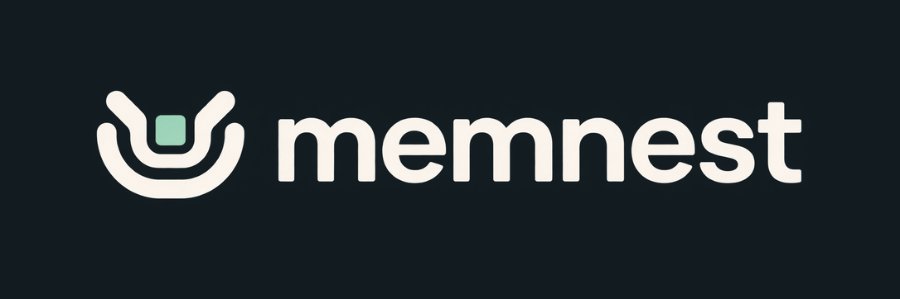
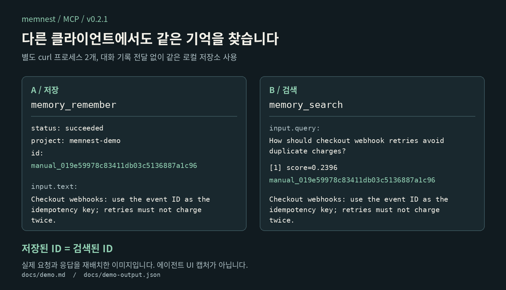

# memnest

<!-- markdownlint-disable MD013 MD033 -->



[English](README.md) | [한국어](README.ko.md)

코딩 AI는 세션이 끝나면 다 잊어버립니다. Memnest를 쓰면 전에 무엇을 왜 결정했는지 AI가 다시 찾아볼 수 있습니다. AI가 쓴 요약이 아니라 당시 대화 원문에서 찾습니다.

- **요약이 아니라 원문입니다.** 기록을 고쳐 쓰지 않습니다. 저장과 검색에 모델 API를 쓰지 않으니 API 키도, 추가 토큰 비용도 없습니다. 모든 결과에 열어볼 수 있는 출처 ID가 붙습니다.
- **코딩 AI 여러 개가 기억 하나를 같이 씁니다.** Claude Code, Codex, Cursor, pi가 같은 로컬 서비스에 연결됩니다. Claude Code에서 정한 내용을 Codex에서 찾을 수 있습니다.
- **내 컴퓨터에 남습니다.** Rust 실행 파일 하나에 SQLite와 로컬 다국어 임베딩 모델로 동작합니다.

[](https://github.com/Blue-B/memnest/releases/latest)
[](https://www.npmjs.com/package/pi-memnest)
[](LICENSE)

## 기능

| 기능 | 하는 일 | 지원 도구 |
|---|---|---|
| 검색 | 지난 결정을 당시 대화 원문에서 찾고, 열어볼 수 있는 출처 ID를 붙임 | 모든 도구 |
| 저장과 정정 | 요청하면 결정을 저장하고, 바뀐 사실은 이전 기록과 연결해 대체 | 모든 도구 |
| 대화 자동 수집 | `memnest watch`가 로컬 대화 기록에서 보이는 대화를 저장 | Claude Code, Codex, pi |
| [작업 카드](docs/task-cards.ko.md) | 며칠 걸리는 작업을 새 세션으로 이어 가는 인계 문서. 사용자 말은 원문 그대로 보관 | pi, Claude Code, Codex (그 밖의 MCP 도구는 저장과 열기만) |
| 자동 회상 (선택) | 질문마다 관련 기억을 함께 넣음 | pi, Claude Code, Codex |
| [코드 근거](docs/code-evidence.ko.md) | 기록에 파일 기준을 붙이고 나중에 비교 | 모든 도구 |
| [과거 기록 가져오기](docs/history-import.ko.md) | 설치 전 대화를 추가 | CLI |
| 금고 (선택) | 자격 증명을 일반 기억과 분리해 암호화 저장 | 모든 도구 |
| [팀 권한](docs/team-access.ko.md) (선택) | 프로젝트 권한, 감사, 보존 정책 | 서버 |
| [웹 커넥터](docs/web-connectors.ko.md) | 자기 서버에서 접속하는 클라우드 AI를 공개 URL로 연결 | ChatGPT, Claude 커넥터, Grok |

Claude Code, Codex, Cursor, pi 같은 로컬 앱은 `127.0.0.1`로 바로 연결되므로 웹 커넥터가 필요 없습니다. `memnest watch`는 실행 중인 시스템(macOS, Linux, WSL)의 홈 폴더에서 대화 기록을 읽습니다. WSL에서 Windows 쪽에서 실행되는 앱의 기록은 `memnest watch --path /mnt/c/Users/<사용자>/.claude/projects`처럼 경로를 지정해야 합니다.

## 설치

```bash
curl -fsSL https://raw.githubusercontent.com/Blue-B/memnest/main/core/scripts/install.sh | bash
```

서버와 대화 수집기를 시작하고, 찾은 Claude Code, Codex, Cursor 설정에 작업 카드 훅까지 Memnest를 추가합니다. 기존 설정은 먼저 백업하고 복구 명령을 출력합니다. Codex는 새 훅을 처음 한 번 `/hooks`에서 신뢰해야 실행합니다.

필요 환경: Apple Silicon macOS, 또는 systemd가 있는 Linux(x86_64는 glibc 2.35 이상, Arm64는 glibc 2.39 이상)와 Python 3. 처음 저장하거나 검색할 때 약 1.1GB 임베딩 모델을 내려받습니다.

- **pi:** `pi install npm:pi-memnest@0.4.0`을 실행하고 `/memnest`로 연결을 확인합니다. pi의 작업 카드는 확장 0.5.0이 필요한데 아직 npm에 없으므로, 저장소를 받은 뒤 `pi install ./pi-extension`으로 설치합니다. [확장 설정](pi-extension/README.ko.md)
- **그 밖의 MCP 도구:** `http://127.0.0.1:3111/mcp`에 연결합니다. [연결 예시](adapters/README.ko.md)
- **버전 고정, 업그레이드, 소스 빌드:** [운영 문서](docs/operations.ko.md)

## 사용법

AI에게 평소 말투로 물어보면 됩니다.

> 작업 관리 도구를 바꾼 이유가 뭐였지? 그때 논의를 찾아줘.
>
> 지난번에 이 오류가 났을 때 뭘 시도했었지?

AI가 검색하고 원문 기록을 읽은 뒤, 확인할 수 있는 출처 ID와 함께 답합니다. 검색 범위는 현재 작업공간과 공통 `playbook`이고, 전체를 찾으려면 `project=all`을 요청합니다. 매번 지켜야 할 규칙 몇 개라면 `AGENTS.md`나 `CLAUDE.md`가 더 간단합니다.

도구: `memory_search`, `memory_get`, `memory_remember`, `memory_update`, `memory_delete`, `task_card`

[](docs/demo.ko.md)

## 작업 카드

한 작업을 세션 하나로 며칠 이어 쓰면, 압축이 반복되면서 사용자가 한 지적이 요약에서 빠집니다. 작업 카드는 그 작업의 인계 문서입니다. 카드 본문은 AI가 쓰고, 사용자 말은 Memnest가 원문 그대로 붙입니다. 다음 날 새 세션은 이 카드를 열어 이어 갑니다. 작업 카드는 다음 릴리스에 포함됩니다.

5일 동안 이어 쓴 실제 pi 세션에서 사용자가 불만을 말한 장면을 다시 돌려 측정했습니다.

| 측정 | 카드 없음 | 카드 사용 |
|---|---|---|
| 그 답 한 번에 읽은 맥락 토큰 | 321,213 | 174,118 |
| 사용자 방침과 어긋난 제안을 하지 않음 (블라인드 채점, 3회) | 0/3 | 3/3 |
| 새 세션에서 그 작업 질문 5개: 정확도, 답 하나당 토큰 | 19/20, 73,002 | 22/22, 19,632 |

[동작 방식, 도구별 차이, 한계](docs/task-cards.ko.md)

## 알아둘 점

- 검색이 기록을 놓칠 수 있고, 옛 결정이 지금도 맞는지는 판별하지 못합니다.
- 보이는 대화 텍스트만 수집합니다. 추론 내용, 도구 출력, 이미지, ChatGPT와 Claude의 내장 메모리는 가져오지 않습니다.
- 답변은 연결한 AI가 씁니다. 클라우드 AI에 보낸 기억은 그 제공자가 받습니다.
- 일반 기억은 암호화되지 않습니다. 3111 포트를 인터넷에 열지 마세요.
- 웹 커넥터 URL은 기억에 들어가는 비밀번호처럼 동작합니다.
- 삭제한 기록은 휴지통에 30일 남고, 백업과 예전 대화 기록에는 복사본이 남을 수 있습니다. [보안과 삭제 범위](SECURITY.ko.md)

## 문서

- [운영과 백업](docs/operations.ko.md), [설계 결정](docs/design-decisions.ko.md), [개발 안내](CONTRIBUTING.ko.md)
- [실제 클라이언트 검증](docs/client-validation.ko.md), [재현 데모](docs/demo.ko.md), [검색 평가](benchmarks/memorybench/README.ko.md), [로컬 비교](docs/local-provider-comparison.ko.md)
- [최신 릴리스](https://github.com/Blue-B/memnest/releases/latest), [변경 이력](core/CHANGELOG.ko.md)

## 라이선스

MIT © Blue-B
