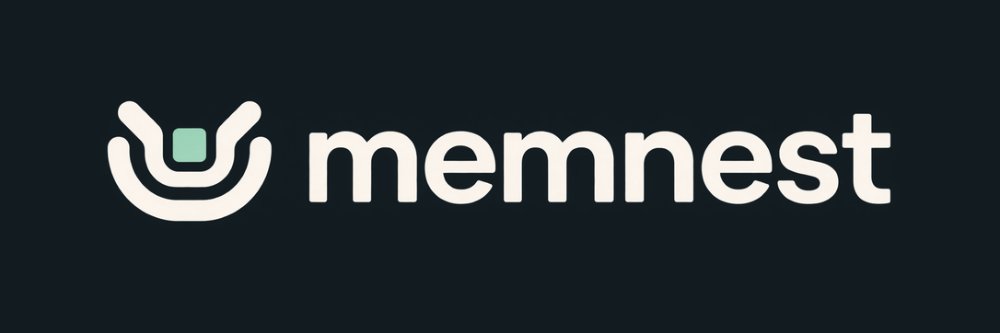
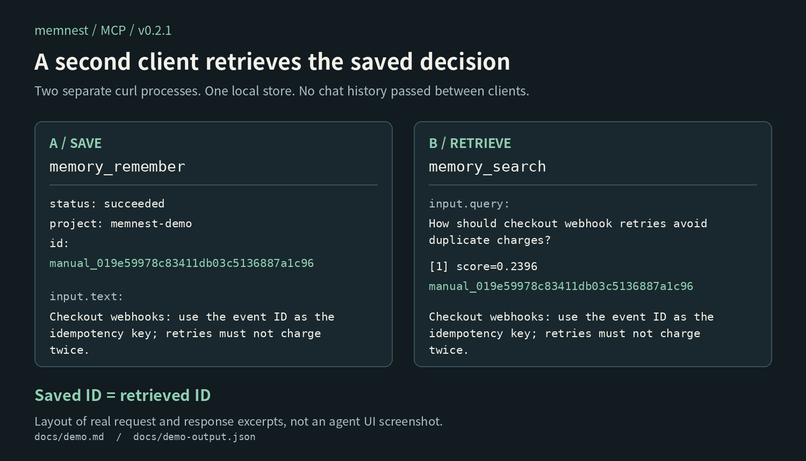

# memnest

<!-- markdownlint-disable MD013 MD033 -->



[English](README.md) | [한국어](README.ko.md)

Your coding AI forgets everything when the session ends. Memnest lets it look up what you decided before, and why, from the original conversation instead of an AI-written summary.

- **Original text, not summaries.** Saving and searching call no model API, so there is no API key and no extra token bill. Every result has a source ID you can open.
- **One memory for every coding AI.** Claude Code, Codex, Cursor, and pi share one local service. Decide something in Claude Code, find it from Codex.
- **Stays on your machine.** One Rust binary with SQLite and a local multilingual embedding model.

[](https://github.com/Blue-B/memnest/releases/latest)
[](https://www.npmjs.com/package/pi-memnest)
[](LICENSE)

## Install

```bash
curl -fsSL https://raw.githubusercontent.com/Blue-B/memnest/main/core/scripts/install.sh | bash
```

On Windows, in PowerShell (no administrator rights needed):

```powershell
irm https://raw.githubusercontent.com/Blue-B/memnest/main/core/scripts/install.ps1 | iex
```

This starts the server and the conversation watcher, and connects the Claude Code, Codex, and Cursor setups it finds. Existing configuration is backed up first, and the restore command is printed. Codex runs the new hooks after you trust them once with `/hooks`.

Needs macOS on Apple Silicon, Linux with systemd (x86_64 with glibc 2.35+, Arm64 with glibc 2.39+), or 64-bit x86 Windows 10/11, and Python 3. On Windows, Python is only used to connect clients, and the Windows archive starts with the release after v0.5.1 ([details](docs/operations.md#windows)). The first write or search downloads an embedding model of about 1.1 GB.

- pi: `pi install npm:pi-memnest@0.5.0`, then check with `/memnest`.
- Other MCP clients: connect to `http://127.0.0.1:3111/mcp` ([examples](adapters/README.md)).

## Use it

Ask in plain words. Your AI picks the tool.

| You say | What happens |
|---|---|
| "Why did we switch task managers? Find the discussion behind that decision." | `memory_search` finds the records, `memory_get` opens the original, and the answer cites source IDs you can check |
| "Remember this: we deploy from the release branch only, never on Fridays." | `memory_remember` saves it as written. Any connected AI can find it later |
| "That is outdated, the staging port is 8443 now. Update the memory." | `memory_update` replaces it and keeps the earlier version in history |
| "Search all projects for the payment webhook decision." | Search normally covers the current folder's workspace and the shared `playbook`; this one covers everything |
| "Make a task card for this migration." Next day: "Continue the migration card." | `task_card` saves the plan and your own words, and the next session opens it |

A search result is the stored text with its project, score and ID:

```text
[1] project=shop-api score=0.2531 id=manual_5ea65b71... doc_len=96
    Deploy from the release branch only, never on Fridays. Decided 2026-10-02 after the Friday rollback.
hint: stronger matches exist outside this workspace scope: billing (2). Search again with project="billing" (or project="all").
```

The `hint` line appears when another project holds clearly better matches than the folder you are in. It names the project and a count, never the text.

Tools: `memory_search`, `memory_get`, `memory_remember`, `memory_update`, `memory_delete`, `task_card`.

[](docs/demo.md)

## How it works

```text
 Claude Code      Codex      Cursor      pi        ChatGPT, Claude, Grok (web)
   MCP + hook   MCP + hook    MCP     extension    read-only gateway (optional)
       |            |          |          |                    |
       +------------+----------+----------+--------------------+
                                |
                 memnest server (one Rust binary, 127.0.0.1:3111)
                   save       text stored as written, embedded locally
                   search     keyword (BM25) + vector, fused and ranked
                   context    memories on the prompt's topic, for the hook
                   task cards, vault
                                |
                 ~/.memnest
                   memory.db    SQLite, the source of truth
                   text_index   keyword index (Tantivy)
                   vectors      vector index
                   models       multilingual-e5-base, runs on the CPU
                   master.key   key for the vault (AES-256-GCM)

 memnest watch: reads the session files of Claude Code, Codex and pi
                and stores each visible turn through the same server
```

1. **Save.** A memory is stored exactly as it was written. Nothing rewrites or summarizes it. A small local model turns the text into numbers (an embedding) so it can be found by meaning later.
2. **Search.** Two searches run on the same question: keyword search finds the same words (file names, numbers, exact terms), vector search finds the same meaning in different words. The two rankings are merged, memories you saved on purpose rank above raw conversation turns, older ones rank lower, and near-duplicates are thinned out. Three results come back by default, each with an ID.
3. **Automatic recall.** With the prompt hook, memnest looks up memories when you send a prompt and adds only the ones on that prompt's topic. A vague prompt gets none.
4. **Scope.** Each folder you work in is its own workspace. `playbook` is shared by all of them. Credentials go to the encrypted vault and never appear in search.

No language model runs in any of these steps, which is why saving and searching need no API key. Design reasons: [design decisions](docs/design-decisions.md). How search ranks and what it was measured on: [benchmarks](docs/benchmarks.md).

## Task cards

For work that runs over several days. Your AI writes the card, Memnest adds your own messages to it word for word, and the next session opens the card and continues. In a replay of a real five-day pi session, the reply read 174K context tokens instead of 321K. Your stated policy was respected in 3 of 3 blind-graded runs with the card, against 0 of 3 without it. A card does not force the model to follow it. [How it works and limits](docs/task-cards.md)

## Commands in pi

Type these in pi to look at memnest yourself. They run without the model and add nothing to its context.

| Command | What it does |
|---|---|
| `/memnest` | Service health, number of memories, task cards, and which card this session records into |
| `/memnest-cards` | Task cards, newest first. Pick one to read it, open or close it in this session, or mark it done |
| `/memnest-search <question>` | The same search your AI runs, up to 10 results. Pick one to read it in full. Start with `project:<name>` or `project:all` to change the scope |
| `/memnest-recent` | The 20 newest memories that were saved on purpose (not conversation turns) |
| `/memnest-review` | Goes through saved rules and preferences, longest unconfirmed first. For each: keep, delete (to the trash, restorable for 30 days), skip, or stop |

`/memnest-review` is there because memnest cannot tell whether an old rule still holds; you can. The four `/memnest-...` commands, the `hint` line and topic-filtered recall are on the `develop` branch and come with the release after core 0.5.1 and pi-memnest 0.5.0.

## Also included

Conversation capture (`memnest watch`), [history import](docs/history-import.md), [code evidence](docs/code-evidence.md), an encrypted vault for credentials, [team access](docs/team-access.md), and [web connectors](docs/web-connectors.md) for ChatGPT, Claude, and Grok. Automatic recall is off unless you turn it on.

## Limits

- Search can miss a record, and it cannot tell whether an old decision still holds. On two public test sets, measured without any language model, the conversation that holds the answer is among the first 5 results for 96% of questions (LongMemEval-S, 200 sampled questions; released 0.5.1: 93.5%), and the exact line that holds the answer is among the first 10 for 77% (LoCoMo; 0.5.1: 70%). These count whether the memory was found, not whether the AI then answered correctly. [What was tested and how to read it](docs/benchmarks.md)
- Capture keeps visible conversation text only: no reasoning, tool output, or images.
- Memories your AI reads are sent to its provider. Regular memories are not encrypted, so do not expose port 3111 to the internet; a web connector URL works like a password.
- Deleted records stay in trash for 30 days, and backups may keep copies. See [security](SECURITY.md).

## More

[Operations, upgrades, and backups](docs/operations.md), [changelog](core/CHANGELOG.md), [contributing](CONTRIBUTING.md)

## License

MIT © Blue-B
