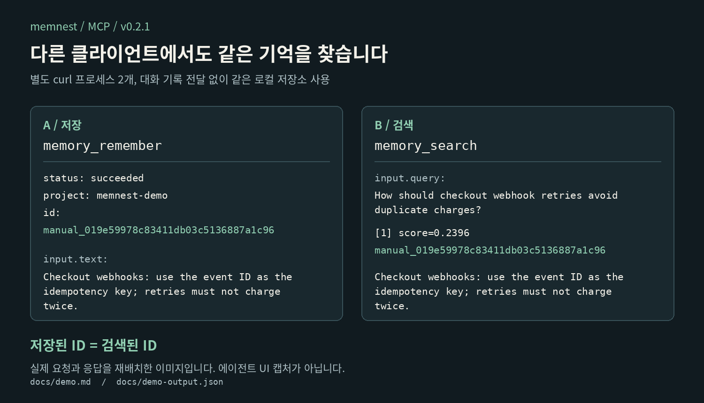

# 서로 독립된 두 클라이언트, 저장된 결정 하나

<!-- markdownlint-disable MD013 -->

[English](demo.md) | [한국어](demo.ko.md)

이 데모는 좁은 주장 하나만 확인합니다. 하나의 Memnest 서비스에 연결된 서로 독립된 두 클라이언트가 같은 기록을 저장하고 찾을 수 있다는 것입니다. curl을 따로 두 번 실행합니다.

1. 클라이언트 A가 **Streamable HTTP 기반 MCP**로 `memory_remember`를 호출합니다.
2. 클라이언트 B는 A의 프로세스나 대화 상태를 전혀 받지 않고 **JSON HTTP API**로 `/search`를 호출합니다.
3. 로컬 검증기가 돌아온 기억 ID와 전체 텍스트가 같은지 확인합니다.
4. 스크립트는 Codex가 쓰는 JSONL 형식의 합성 대화 기록을 `memnest watch`에 넣고 검색되는지도 확인합니다. Codex가 이 자료를 만들었다고 주장하지 않고, 실제 파서만 확인합니다.

모두 [지원하는 Memnest 클라이언트 연결 방식](../adapters/README.ko.md#지원하는-연결-방식)입니다. 서로 독립된 통신 클라이언트 사이의 저장 지속성과, 배포되는 대화 기록 파서 하나를 시험합니다. Claude Code, Codex, pi, LLM을 실행하지 않으며, 자율 에이전트가 기억을 저장하거나, 떠올리거나, 믿거나, 적용하기로 스스로 정하는지는 시험하지 않습니다.

별도의 [실제 클라이언트 시도](client-validation.ko.md)에서는 pi 검색 경로가 통과했습니다. Claude Code와 Codex는 도구를 쓰기 전에 계정 접근과 사용량 오류로 멈춰서, 그 시도는 에이전트 간 데모로 내세우지 않습니다.

## 실행하기

필요한 것은 실행 중인 Memnest 서비스, `memnest` 실행 파일, Bash, curl, Python 3입니다. 기록 스크립트는 npm이나 Python 패키지를 쓰지 않습니다. 기본 서비스 주소는 `http://127.0.0.1:3111`이고, 실행 파일이 `PATH`에 없으면 `MEMNEST_BIN`을 설정합니다.

```bash
./docs/run-independent-client-demo.sh /tmp/memnest-demo-evidence
cat /tmp/memnest-demo-evidence/transcript.txt
```

다른 로컬 주소를 쓰려면 `MEMNEST_URL`을 설정합니다. 서비스에 bearer 인증이 있으면 `MEMNEST_TOKEN`을 설정하세요. 토큰은 헤더로만 보내고 증거 파일에는 쓰지 않습니다.

스크립트는 가상의 결정 하나를 고유한 `memnest-demo-<timestamp>-<pid>` 프로젝트에 씁니다. 그래서 같은 서비스에 여러 번 돌려도 서로 중복 처리되지 않습니다. 프로젝트 범위는 검색 결과를 나눌 뿐 데이터베이스 파일을 나누지는 않습니다. 깨끗하게 돌리려면 자체 데이터 폴더를 쓰는 일회용 서비스를 띄우세요.

```bash
DATA_DIR="$(mktemp -d)"
memnest --data-dir "$DATA_DIR" --port 3111
# 두 번째 터미널에서 위의 기록 명령을 실행합니다.
# 끝나면 서비스를 멈추고 "$DATA_DIR"을 지웁니다.
```

첫 저장이나 검색 때 로컬 임베딩 모델을 내려받을 수 있습니다. 이 처음 준비 시간은 터미널 녹화의 편집된 시간에 포함되지 않았고, 요청 제한 시간 5분보다 길 수 있습니다. `--warmup-embedding`은 [운영 문서](operations.ko.md#cli-참고)를 보세요.

## 만들어지는 증거

결과 폴더에는 다음이 들어 있습니다.

| 파일 | 의미 |
| --- | --- |
| `client-a-mcp-request.json` | 클라이언트 A가 보낸 JSON-RPC 도구 요청 그대로 |
| `client-a-mcp-response.json` | 저장 ID를 포함한 MCP 응답 전체 |
| `client-b-http-request.json` | 클라이언트 B가 보낸 JSON 요청 그대로 |
| `client-b-http-response.json` | 순위가 매겨진 결과 ID와 텍스트를 포함한 HTTP 응답 전체 |
| `health.json` | 실행 당시 서비스 상태 응답 |
| `codex-transcript/session.jsonl` | Codex가 쓰는 `session_meta` + `event_msg` JSONL 형식의 합성 자료 |
| `watch-output.txt` | `memnest watch`가 그 자료를 파싱해 보낸 출력 |
| `transcript-search-*.json` | 파싱한 자료를 찾을 수 있음을 보여 주는 요청과 원본 응답 |
| `manifest.json` | 보고된 서비스 버전, 확인한 ID, 범위 설명, SHA-256 해시 |
| `transcript.txt` | 원본 응답으로 만든 사람이 읽기 쉬운 터미널 기록 |
| `demo.cast` | 원본 응답으로 약 45초 분량에 맞춘 Asciicast v2 JSONL |

클라이언트 A가 `status: succeeded`를 보고하고 클라이언트 B가 정확히 그 ID와 텍스트를 돌려주지 않으면 스크립트는 0이 아닌 코드로 끝납니다. HTTP 성공만으로는 도구 성공으로 치지 않습니다.

저장소의 [증거 폴더](demo-evidence/)는 일회용 서비스로 한 번 돌린 결과입니다. 재생 프로그램 없이 보려면 `transcript.txt`나 JSONL cast를 읽으세요. asciinema가 설치돼 있다면 이렇게 재생합니다.

```bash
asciinema play docs/demo-evidence/demo.cast
```

이 cast는 화면 녹화가 아닙니다. 기록 스크립트가 실행의 원본 응답으로 만들고 설명용 멈춤을 넣었습니다. manifest의 해시로, 그 실행에 쓴 원본 파일이 바뀌지 않았는지 확인할 수 있습니다.

## 예전 시각 자료



이 그림과 [원본 응답 파일](demo-output.json)은 예전 v0.2.1의 MCP 간 실행 결과입니다. 읽기 쉽게 Pillow로 일부 필드를 배치했으며, 에이전트 화면 캡처가 아니고 이미지 모델이 만든 결과도 아닙니다. 한국어 그림은 원래 도구 데이터를 유지한 채 라벨만 번역했습니다. 영어 그림은 [demo-result.png](demo-result.png)입니다.

어느 기록도 정확도나 지연 시간 비교 벤치마크가 아닙니다. ID, 점수, 걸린 시간은 실행마다 다릅니다.

## 에이전트로 해 보기

[연결 안내](../adapters/README.ko.md#mcp-클라이언트)대로 두 에이전트 호스트를 같은 HTTP 서비스에 연결합니다. 아래 프롬프트는 성공 조건을 분명히 합니다.

클라이언트 A에서:

```text
Call memory_remember exactly once with project="memnest-demo-agent" and this text:
"Checkout webhook retries must reuse the original event ID."
Return the stored record ID.
```

클라이언트 B에서 새 세션을 시작하고:

```text
Call memory_search in project="memnest-demo-agent" for:
"How do checkout retries avoid duplicate processing?"
Report the matching record ID and quote the stored text. Do not answer from general knowledge.
```

클라이언트 B의 도구 결과에 클라이언트 A의 기록 ID와 정확한 텍스트가 있을 때만 성공으로 칩니다. 모델의 답만 믿지 말고 실제 도구 호출을 확인하세요.

이것은 별도의 대화형 시험입니다. 스크립트로 한 통신 데모가 성공했다고 해서, 특정 에이전트가 스스로 도구를 골랐다는 증거가 되지는 않습니다. 저장한 결제 규칙은 가상이며 완전한 결제 구현이 아닙니다.

## 예시 지우기

데모를 여러 번 저장하며 받은 모든 기억 ID로 `memory_delete`를 호출합니다. 삭제는 휴지통으로 옮기는 방식이고, 보관 기간은 [운영 문서](operations.ko.md#보존과-복구)에 있습니다.
